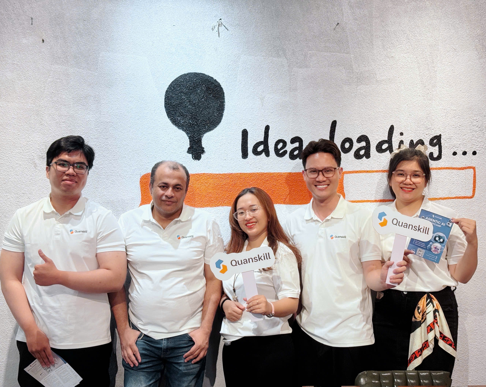

## The story behind the role

Quanskill gave me my first opportunity to teach. I began with little teaching experience, so preparing for each session meant revisiting what I had learned and finding a clearer way to explain it. Over six months, teaching programming, mathematics, and AI helped me grow more confident in my own understanding.

What stayed with me most was the range of people who wanted to learn: students, employees, and business leaders from different fields. Their questions showed me that AI was not just a technical subject in a classroom. It could help people solve problems in their work, and making those ideas accessible was a way for me to create value.

<figure class="experience-photo experience-photo--wide">
  
  <figcaption>With the Quanskill team at an AI learning event.</figcaption>
</figure>

## What I worked on

- Taught programming, mathematics, and AI through live sessions, from foundational concepts to computer vision and natural language processing.

- Created recorded videos, slides, documents, and exercises to support independent learning; contributed to practical AI workshops.

- Contributed as an AI Builder to DataVision, a platform connecting data ingestion, dashboards, prediction, RAG chatbot, AI suggestions, and report generation.
