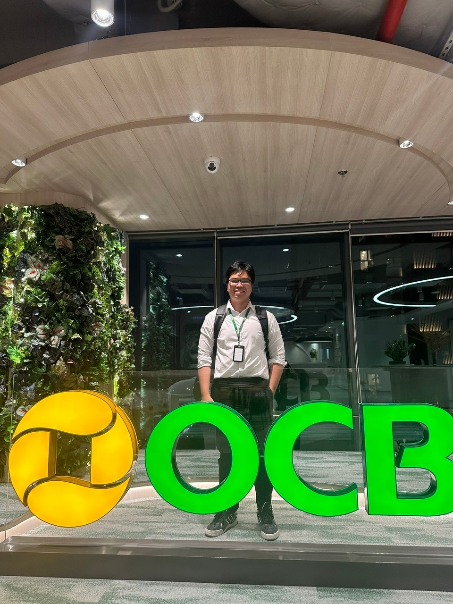

## The story behind the role

I had hoped for the chance to work as a Data Scientist in finance for a long time, and joining OCB gave me that opportunity. I arrived with an engineering mindset: I was focused on data, models, and deployment. Working in a bank taught me to ask another question first: what decision is this model meant to support, and how does it serve the business while managing risk?

I learned about the banking domain and the credit-model lifecycle, and saw how Data Science connects with underwriting, risk, collections, and marketing. The experience changed the way I think about a good solution. Technical performance matters, but so do its purpose, constraints, and the people who will use it. The habit of thinking carefully about risk has stayed with me beyond work.

I also valued the people I met. Colleagues from different backgrounds shared their perspectives generously, and those conversations helped me see problems from more than one angle. Some became meaningful connections I still appreciate.

  <figure class="experience-photo">
    
    <figcaption>After a deadline on a rainy evening. Tired, but still excited about the work.</figcaption>
  </figure>
  <figure class="experience-photo">
    
    <figcaption>A quieter moment in the OCB lobby.</figcaption>
  </figure>

## What I worked on

- Worked across the banking credit-model lifecycle, including data sourcing, exploratory analysis, feature engineering, modeling, and validation, with attention to business requirements and risk management.

- Supported online and offline feature store development on Databricks using defined feature specifications and transformation logic.

- Contributed to the team deployment of three ML models using Databricks Model Serving, including API response contracts and coordination with data governance and IT teams; explored MLflow and MLOps workflows.

- Proposed AI product ideas including cross-sell modeling, recommendation systems, and Smart Paste; explored linear programming for profit maximization under business constraints.
